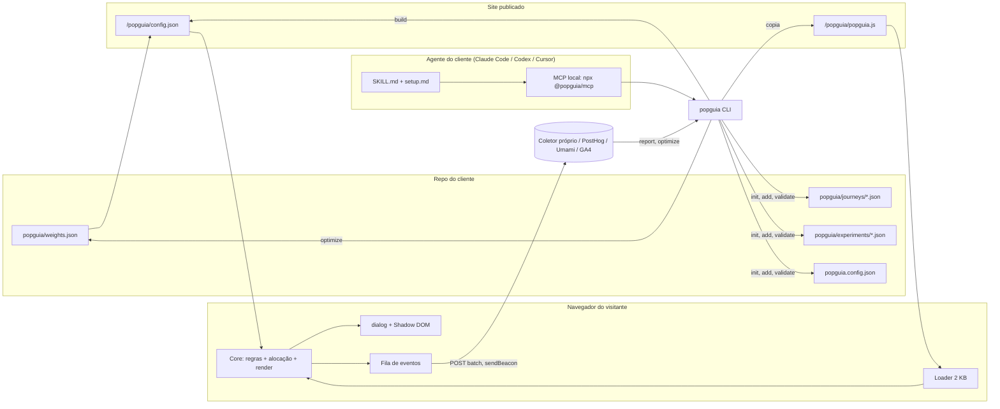

# 04 — Arquitetura

> Proposta nossa `[inferência]`, apoiada nos fatos de `01`–`03` e `05`–`06`. Metas numéricas marcadas `[estimativa]` até serem medidas.

## 1. Visão em uma frase

Um **widget leve** que lê uma **configuração estática** gerada a partir de **arquivos JSON no repo do cliente**, decide localmente **o que mostrar, quando e para quem**, envia **eventos** para um sink configurável, e é **instalado e editado por agentes** via CLI/MCP/skill — com um job de **otimização** (A/B → bandit) que reescreve os pesos como arquivo.

## 2. Componentes

| # | Componente | Pacote (monorepo pnpm) | Onde roda | Responsabilidade |
|---|---|---|---|---|
| 1 | **Widget** | `@popguia/widget` → `popguia.js` | navegador do visitante | loader + core: carrega config, avalia gatilhos/audiência/frequência, aloca variante, renderiza jornada em `<dialog>` + Shadow DOM, emite eventos |
| 2 | **Schema** | `@popguia/schema` | todo lugar | JSON Schema + tipos TS de Jornada, Etapa, Variante, Experimento, Evento, Config; validador (zod ou ajv) |
| 3 | **Engine** | `@popguia/engine` | navegador **e** Node | puro TS sem DOM: avaliação de regras, hashing determinístico de alocação, Thompson sampling, cálculo de SRM/posteriores; o mesmo código roda no widget (decisão) e no CLI (otimização) |
| 4 | **CLI** | `popguia` | máquina do dev / CI | `init`, `add`, `validate`, `build` (gera `config.json`), `preview`, `doctor`, `report`, `optimize`, `gerar`, `mcp` |
| 5 | **MCP** | `@popguia/mcp` (ou `popguia mcp`) | local, stdio | casca sobre o CLI com as ferramentas de `03 §2.3` |
| 6 | **Skill + docs** | `skills/popguia/SKILL.md`, `docs/` (GitHub Pages) | contexto do agente | `setup.md`, `llms.txt`, páginas `.md`, templates de jornada |
| 7 | **Coletor** | `@popguia/collector` | Cloudflare Worker + D1 (ou Supabase/Postgres; ou adaptador externo) | recebe eventos (POST batch, `sendBeacon`), grava, agrega; endpoint de leitura para `report/optimize` |
| 8 | **Adaptadores de sink** | dentro do widget (tree-shaken) | navegador | `collector`, `posthog`, `umami`, `ga4`, `console`, `custom(fn)` |
| 9 | **Plugin WordPress** | `popguia-wp` (GPL) | PHP | enfileira o script, serve `config.json`, tela mínima de colar JSON |
| 10 | **Painel** (fase SaaS) | `apps/painel` | web | leitura de métricas de vários sites; **não** é editor visual no MVP — o relatório vem do CLI (`report --html`) |

**Não existe editor visual no MVP.** O "editor" é o agente + arquivos JSON + `preview`. Isso é a aposta do projeto; se o mercado pedir UI, o GrapesJS (BSD-3) é a referência.

## 3. Diagrama



Fluxo de dados: **arquivos → build → config estático → decisão local → eventos → otimização → arquivos**. Cada volta do ciclo é um commit (auditável) ou, na fase SaaS, uma escrita do painel.

## 4. Modelo de dados

### 4.1 Entidades (resumo; o schema completo vai em `@popguia/schema`)

```ts
type Config = {
  versao: string; site: { id: string; dominio: string; idioma: 'pt-BR'|'en'|'es' };
  sink: { tipo: 'collector'|'posthog'|'umami'|'ga4'|'console'|'custom'; url?: string; chavePublica?: string };
  consentimento: { modo: 'nenhum'|'cmp'|'proprio'; categoriaNecessaria?: string; eventoCmp?: string }; // ver 06
  frequencia: { maxPorSessao: number; cooldownGlobalSeg: number; reexibirAposDias: number; nuncaAposConversao: boolean };
  limites: { descontoMaxPct?: number; incentivoMaxPorLead?: number };            // guard-rails
  ia?: { provedor: 'openai'|'anthropic'|'ollama'|'openrouter'; modelo: string; chaveEnv: string }; // opcional, chave do cliente
};

type Jornada = {
  id: string; nome: string; status: 'rascunho'|'ativa'|'pausada'; objetivo: Meta;
  gatilhos: Gatilho[];            // OR entre eles
  audiencia: Regra[];             // AND entre elas
  frequencia?: Partial<Config['frequencia']>;
  etapas: Etapa[]; inicio: string; // id da etapa inicial
  layout: 'modal'|'slide-in'|'barra'|'inline'|'teaser';
  tema?: Record<string,string>;   // CSS vars
};

type Etapa =
  | { id; tipo: 'boasvindas'; titulo: string; texto?: string; botao: string; proximo: string }
  | { id; tipo: 'pergunta'; pergunta: string; opcoes: { id; rotulo; pontos?: Record<string,number>; proximo?: string }[]; multipla?: boolean; salvarEm: string; proximo: string }
  | { id; tipo: 'conteudo'; titulo; corpo; midia?; proximo }                               // "Learn"
  | { id; tipo: 'formulario'; campos: ('email'|'nome'|'telefone')[]; consentimentoTexto: string; proximo }
  | { id; tipo: 'recompensa'; tipoRecompensa: 'cupom'|'conteudo'|'link'; valor: string; condicao?: Regra }   // "Earn"
  | { id; tipo: 'recomendacao'; fonte: 'catalogo'; catalogo: string; regra: 'maxPontos'|'custom'; quantidade: number; cta: string }
  | { id; tipo: 'compromisso'; texto: string; botaoSim: string; botaoNao: string; proximoSim; proximoNao }  // microcompromisso
  | { id; tipo: 'final'; titulo; texto?; cta?: { rotulo; url } };

type Gatilho =
  | { tipo: 'tempo'; segundos: number }
  | { tipo: 'scroll'; pct: number }
  | { tipo: 'saida'; desktop: boolean; mobile: 'scrollUp'|'voltar'|'inatividade'|'nenhum' }
  | { tipo: 'inatividade'; segundos: number }
  | { tipo: 'clique'; seletor: string }
  | { tipo: 'evento'; nome: string }          // window.popguia.push({type:'open', jornada})
  | { tipo: 'adaptativo'; minSeg: number; maxSeg: number; grupoPor: ContextoDim[] };

type Regra = { campo: 'path'|'utm_source'|'utm_medium'|'utm_campaign'|'dispositivo'|'novo'|'pais'|'idioma'|'perfil.<chave>'|'acao.<nome>'|'consentimento'|'custom'; op: 'eq'|'neq'|'contains'|'in'|'regex'|'exists'; valor?: unknown };

type Experimento = {
  id: string; jornadaId: string; tipo: 'ab'|'bandit'|'contextual';
  alvo: { tipo: 'jornada'; variantes: string[] } | { tipo: 'elemento'; etapaId; campo; variantes: Variante[] };
  holdout: number;                 // fração sem popup (ex.: 0.1)
  metrica: Meta; metricasGuarda: Meta[];
  contexto?: ContextoDim[];        // 1–3 dimensões (path, utm_source, dispositivo, novo)
  alocacao: 'fixa'|'pesos'; pesos?: Record<string, number>;   // pesos vêm de weights.json
  inicio: string; fim?: string; cadenciaMin?: number; minUsuariosPorBraco: number; minConversoesPorBraco: number;
};

type Meta = { tipo: 'conclusao_jornada'|'lead'|'clique_cta'|'clique_recomendacao'|'compra'|'custom'; nome?: string; valor?: number; janelaDias: number };

type Evento = {
  v: 1; ts: number; site: string; visitante: string /* uuid local */; sessao: string;
  tipo: 'elegivel'|'holdout'|'impressao'|'etapa'|'resposta'|'envio'|'fechou'|'conversao'|'meta'|'erro';
  jornada?: string; experimento?: string; braco?: string; etapa?: string; dados?: Record<string, unknown>;
  ctx: { path: string; utm?: {...}; dispositivo: 'mobile'|'desktop'; novo: boolean; idioma: string; ref?: string };
};

type Perfil = { visitante: string; criadoEm: number; respostas: Record<string, string|string[]>; acoes: Record<string, number>; convertido?: boolean; emailHash?: string }; // localStorage; servidor só se o cliente quiser
```

### 4.2 Decisões de modelo

- **Visitante** = UUID em `localStorage` (chave documentada, criada só após consentimento quando o modo exigir — `06`); **sessão** = 30 min de inatividade. Sem cookie de terceiros, sem fingerprint.
- **Alocação determinística**: `hash(visitante + experimentoId) → [0,1)` (padrão GrowthBook) para A/B e holdout; com pesos (bandit), o intervalo é cortado pelos pesos vigentes → sticky enquanto os pesos não mudam; mudança de pesos re-aloca só visitantes novos (coorte), o que evita SRM dentro do período [fato: prática do GrowthBook, https://docs.growthbook.io/bandits/config].
- **Contexto no bandit** = `contexto[]` do experimento (máx. 3 dimensões) ⇒ um posterior por combinação, com prior herdado do global (pooling). Contextual "de verdade" (LinUCB/TS logístico) só na fase 5.
- **Zero-party**: respostas ficam no `Perfil` local e viram `audiencia` de outras jornadas (`perfil.objetivo eq "agentes"`); só vão ao servidor dentro de `Evento.dados` se `config.enviarRespostas = true`.

## 5. Stack recomendada e justificativa

| Camada | Escolha | Por quê | Alternativa |
|---|---|---|---|
| Linguagem | **TypeScript** em tudo | um só código para engine no navegador e no Node; agentes escrevem TS bem | — |
| Widget | **vanilla TS + `<dialog>` + Shadow DOM**, build com esbuild/tsup, ES2020 | 97% de suporte a `<dialog>` [fato: caniuse]; zero framework = menor peso; Shadow DOM isola CSS do site | Preact (5 KB gz) se o render das etapas ficar verboso |
| Validação | **zod** (gera JSON Schema) ou ajv | o agente precisa de erros legíveis; o MCP devolve o schema | — |
| CLI | **Node 20+, `citty`/`commander`, `@clack/prompts`** | padrão shadcn/Clerk; `--dry-run`/`--diff` obrigatórios | — |
| MCP | **`@modelcontextprotocol/sdk`** (stdio) | padrão; sem conta | HTTP remoto na fase SaaS |
| Coletor | **Cloudflare Worker + D1** (SQLite) | custo zero no free tier, borda global, o Nei já usa Cloudflare [fato: `~/projetos/wifi/ACESSOS-GOOGLE-CLOUDFLARE.md`]; D1 basta para dezenas de milhões de eventos/mês [estimativa] | Supabase (Postgres) se quiser SQL rico; ClickHouse só em escala |
| Otimização | **engine em Node** no CLI (`optimize`), cron do GitHub Actions ou Worker Cron | sem servidor dedicado; resultado é um commit em `weights.json` ou um KV no Worker | — |
| Relatórios | `popguia report --html` (arquivo estático) | sem painel no MVP | painel Next.js na fase SaaS |
| Docs | GitHub Pages + `llms.txt` + `setup.md` + SKILL.md | padrão INEMA (`projetos-landing-guia`) | Mintlify |
| Testes | vitest (engine), Playwright (widget: foco, Esc, CLS, peso) | critérios de pronto do `PLANO.md` | — |
| Python (só offline) | MABWiser / contextualbandits para replay e validação do Thompson | não entra em produção | — |

## 6. Peso-alvo do script e desempenho

| Peça | Alvo gz | Base |
|---|---|---|
| Loader (trecho inicial de `popguia.js`) | **≤ 2 KB** | Intercom loader 2,0 KB, Crisp 2,9 KB, OptiMonk preload 1,7 KB (medidos em `06`) [fato: medição local] |
| Loader + core (`popguia.js` completo: regras + alocação + render de etapas + a11y) | **≤ 15 KB** | a11y-dialog 1,8 KB + driver.js 7,6 KB como ordem de grandeza [fato: bundlephobia]; Typeform embed 14,2 KB como teto [fato: medição local] |
| Config (`config.json`, 1–5 jornadas) | **≤ 5 KB** | [estimativa] |
| Módulos opcionais (recomendação por catálogo, adaptadores extra) | sob demanda | — |
| **Total típico** | **≤ 20 KB gz** | contra posthog-js 101,8 KB [fato: bundlephobia] |

Regras de carregamento: `defer`/`lazyOnload`; core e config após `load` em `requestIdleCallback` com fallback `setTimeout` (Safari desabilita rIC [fato: caniuse]); overlay `position: fixed` + `transform/opacity` ⇒ **CLS do widget = 0**; handlers < 50 ms; sem fontes externas; imagens só com `loading="lazy"` e dimensões fixas.

## 7. Segurança e limites operacionais

- O coletor aceita só `POST` com `site` conhecido e origem permitida; rate limit por IP; payload ≤ 8 KB; sem PII além do que `formulario` envia (e-mail só com consentimento; hash opcional para supressão).
- O widget nunca executa HTML arbitrário da config: textos são renderizados como texto; `midia` só URLs same-origin ou allowlist.
- Nenhum pacote nosso lê `.env`; a chave de IA opcional vem de `process.env[config.ia.chaveEnv]` só no CLI.
- Versionamento semver do `config.json` (`versao`), widget compatível com N-1.
